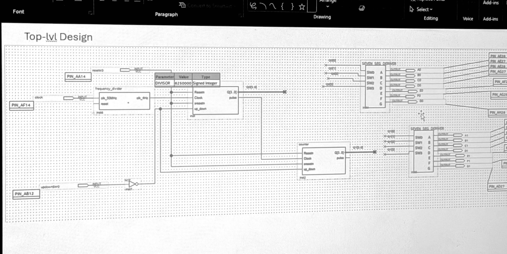

# DE1-SoC Mod-100 Up/Down Counter

A two-digit decimal counter for the Terasic DE1-SoC board, written in Verilog and wired together as a Quartus schematic. It counts 00 to 99 (or 99 down to 00) at four counts per second and shows the value on the HEX1 and HEX0 seven-segment displays.

Final project for EEL 3705L, by John Nguyen.



## Controls

| Board control | Pin | Function |
|---|---|---|
| `CLOCK_50` | PIN_AF14 | 50 MHz clock source |
| `KEY0` | PIN_AA14 | Press to reset the count to 00 (active-low, asynchronous) |
| `SW0` | PIN_AB12 | Down = count up, up = count down |
| `HEX0` | AE26, AE27, AE28, AG27, AF28, AG28, AH28 | Ones digit (segments a to g) |
| `HEX1` | AJ29, AH29, AH30, AG30, AF29, AF30, AD27 | Tens digit (segments a to g) |

At 4 Hz a full 00 to 99 cycle takes 25 seconds.

## Known issue: the divider's reset input is not wired

In the committed schematic, the `reset` input of the `frequency_divider` block has no wire attached. Quartus ties an unconnected input to ground, and this reset is active-low, so the divider is held in reset permanently. The 4 Hz clock never toggles, synthesis removes every register, and the board shows a fixed `00`.

The synthesis report confirms it (`Total registers: 0`, `clk_4Hz ... Stuck at GND due to stuck port clear`).

To fix it, open `Final_Project_John_Nguyen.bdf` and draw a wire from the `K0Reset` net (the one feeding `Resetn` and `presetn` on both counters) to the divider's `reset` pin, then recompile. The Verilog modules themselves are correct and pass their testbenches.

## How it works

```
CLOCK_50 --> frequency_divider --clk_4Hz--> counter (ones) --Q--> hex_to_7seg --> HEX0
                                                |
                                              pulse
                                                v
                                            counter (tens) --Q--> hex_to_7seg --> HEX1

KEY0 ---------> Resetn and presetn of both counters
SW0 --> NOT --> up_down of both counters
```

### `frequency_divider.v`

Divides the 50 MHz board clock down to 4 Hz. A 23-bit counter counts from 0 to `DIVISOR - 1` and toggles the output each time it wraps, so the output period is `2 * DIVISOR` input cycles.

A 4 Hz output has a half-period of 0.125 s, and 50,000,000 × 0.125 = 6,250,000, which is the default `DIVISOR`. The reset is active-low and asynchronous; it clears both the counter and the output.

### `counter.v`

A single BCD digit that counts 0 to 9 up or down. The design uses two of them.

| Port | Meaning |
|---|---|
| `Clock` | Counts on the rising edge |
| `Resetn` | Active-low asynchronous reset to 0. Takes priority over `presetn` |
| `presetn` | Active-low asynchronous preset to 9 |
| `up_down` | 1 = count up, 0 = count down |
| `Q[3:0]` | Current digit |
| `pulse` | Carry/borrow out. High for one clock period after the digit wraps |

The ones digit is clocked by `clk_4Hz`. The tens digit is clocked by the ones digit's `pulse`, so it advances once per wrap (a ripple cascade).

`pulse` is registered rather than decoded from `Q == 9`. A combinational decode would rise when the digit reaches 9, one count early, and the display would go 08, 19, 10. Registering it makes the rising edge land on the wrap itself. It also keeps `pulse` from glitching when `SW0` changes, which would otherwise clock the tens digit by accident.

In the schematic, `Resetn` and `presetn` are tied to the same `KEY0` net. Because reset has priority, pressing `KEY0` gives 00. `SW0` goes through an inverter, so the switch in the down position counts up.

### `hex_to_7seg.v`

A combinational lookup from a 4-bit value to a seven-segment pattern, ordered `{g, f, e, d, c, b, a}`. Outputs are active-low, which matches the DE1-SoC displays. It decodes all sixteen hex values, although the counters only ever produce 0 to 9.

## Building in Quartus

The project was created in Quartus Prime 23.1std.1 Lite Edition for the Cyclone V `5CSEMA5F31C6`. Pin assignments are already in the `.qsf`.

1. Open `Final_Project_John_Nguyen.qpf` in Quartus Prime.
2. Apply the reset-wire fix described under [Known issue](#known-issue-the-dividers-reset-input-is-not-wired).
3. Run **Processing > Start Compilation**. The bitstream is written to `output_files/Final_Project_John_Nguyen.sof`.
4. Connect the board's USB-Blaster port and power it on.
5. Open **Tools > Programmer**, choose **DE-SoC** under **Hardware Setup**, and click **Auto Detect**. Select `5CSEMA5` when asked.
6. Right-click the `5CSEMA5` device, choose **Change File**, and pick the `.sof`. Tick **Program/Configure** and click **Start**.

The project has no `.sdc` file, so expect unconstrained-clock warnings from the timing analyzer. `clk_4Hz` and the ones digit's `pulse` are both clocks generated in logic; at 4 Hz that is harmless.

## Testbenches

Both testbenches are self-checking: they print `[PASS]` or `[FAIL]` for each check and finish with `==== ALL CHECKS PASSED ====` or a failure count. They run in Questa (or ModelSim) from the project folder.

### `tb_frequency_divider.v`

```
vlib work
vlog frequency_divider.v tb_frequency_divider.v
vsim -c work.tb_frequency_divider -do "run -all; quit -f"
```

Simulating 6,250,000 cycles per toggle would be slow, so the testbench overrides `DIVISOR` to 4. It holds reset low and checks that the output stays at 0, then releases reset and measures the time between every pair of output toggles. Each must be `DIVISOR × 20 ns = 80 ns`. The log prints the measured time in picoseconds (`80000`) next to the expected value in nanoseconds (`80`); those are the same interval.

### `tb_counter.v`

```
vlib work
vlog counter.v tb_counter.v
vsim -c -voptargs=+acc work.tb_counter -do "run -all; quit -f"
```

Instantiates two counters wired the same way as the schematic (shared reset/preset, tens digit clocked by the ones digit's `pulse`) and checks the combined two-digit value:

- Reset holds the count at 00.
- Counting up: 09 to 10 carry, reaching 99, and the 99 to 00 wrap.
- Changing direction mid-count, then counting down through the 00 to 99 borrow and 90 to 89.
- An asynchronous reset in the middle of a run.

The testbench drives inputs and samples outputs on the falling clock edge, so nothing changes at the same instant the counter clocks.

To view waveforms, drop `-c` and the `-do` argument so the GUI opens, add the signals to the wave window, and run `run -all`.

## Files

| File | Purpose |
|---|---|
| `Final_Project_John_Nguyen.bdf` | Top-level schematic |
| `Final_Project_John_Nguyen.qpf`, `.qsf` | Quartus project and settings, including pin assignments |
| `frequency_divider.v`, `counter.v`, `hex_to_7seg.v` | Verilog modules |
| `*.bsf` | Schematic symbols |
| `tb_frequency_divider.v`, `tb_counter.v` | Testbenches |
| `top-level-design.jpg` | Photo of the top-level schematic |
